# Heading level one

## Heading level two

### Heading level three

Entities decode and re-escape: 1 &lt; 2 &amp;&amp; 3 &gt; 2.

A paragraph with **strong text**, *emphasis*, `inline code`, ==highlight==,
~~struck-through~~, H~2~O subscript, E = mc^2^ superscript, a
[link with a title](https://example.com/page "Example title"), a
[wiki link](wiki:Other%20note), and a plain reference to notes.md.

A hard break follows here  
and this line starts after it. A soft
break wraps this one.

> A plain blockquote
> spanning two lines.

> [!NOTE]
> A note alert body.

> [!TIP]
> A tip alert body.

> [!IMPORTANT]
> An important alert body.

> [!WARNING]
> A warning alert body.

> [!CAUTION]
> A caution alert body.

- first bullet
- [ ] unchecked task
- [x] checked task

3. third item
4. fourth item

```c
int main(void) { return 0; }
```

```
a fence with no language
```

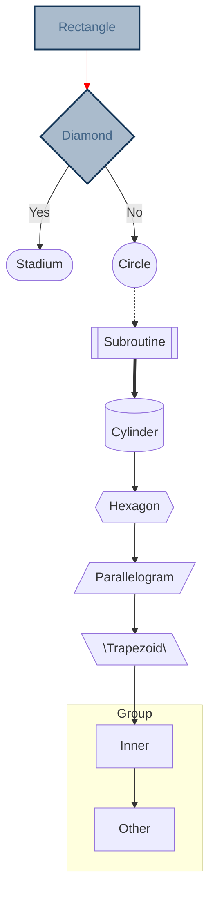

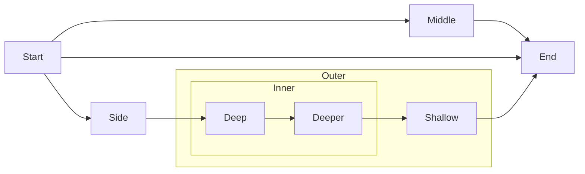

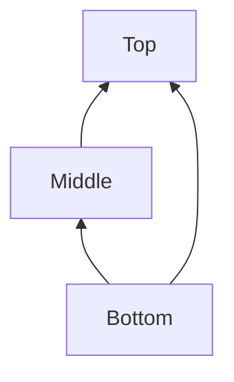

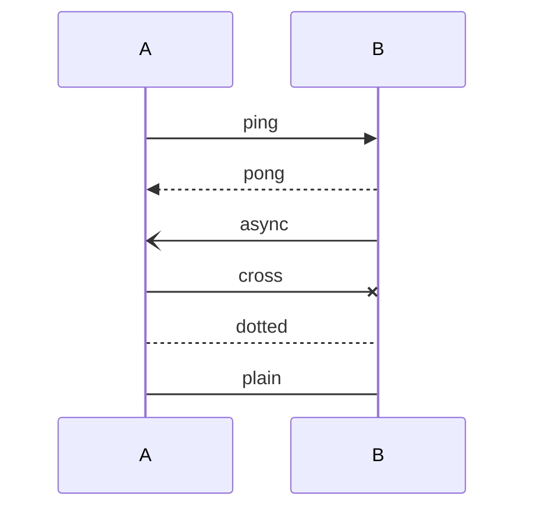

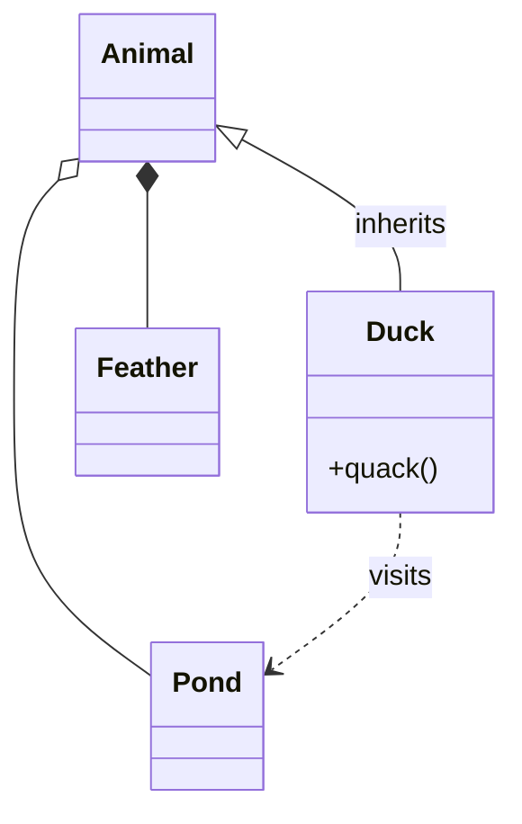

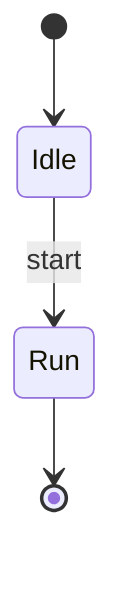

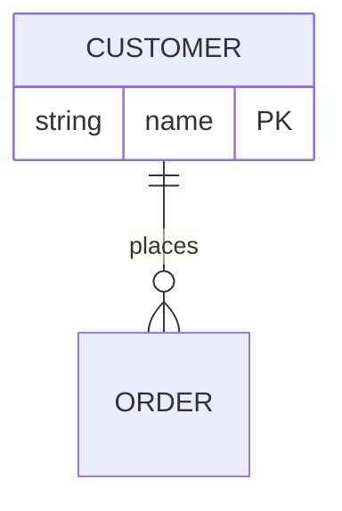

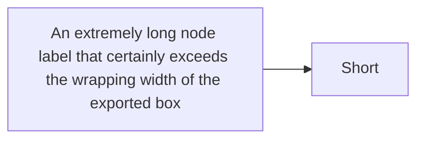

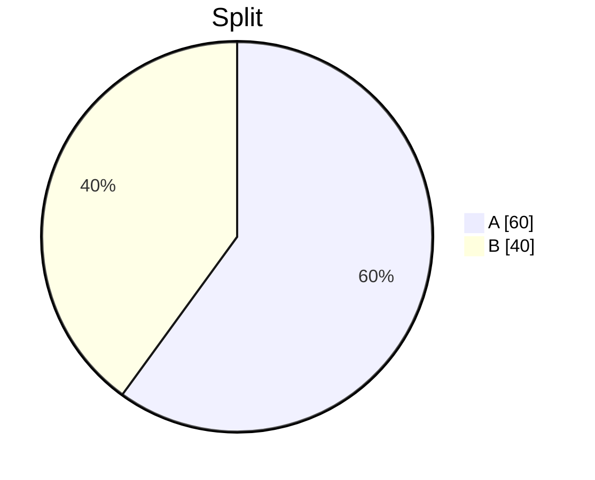

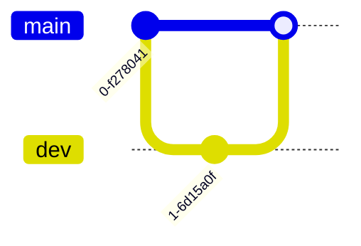

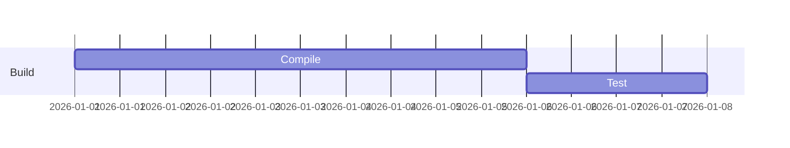

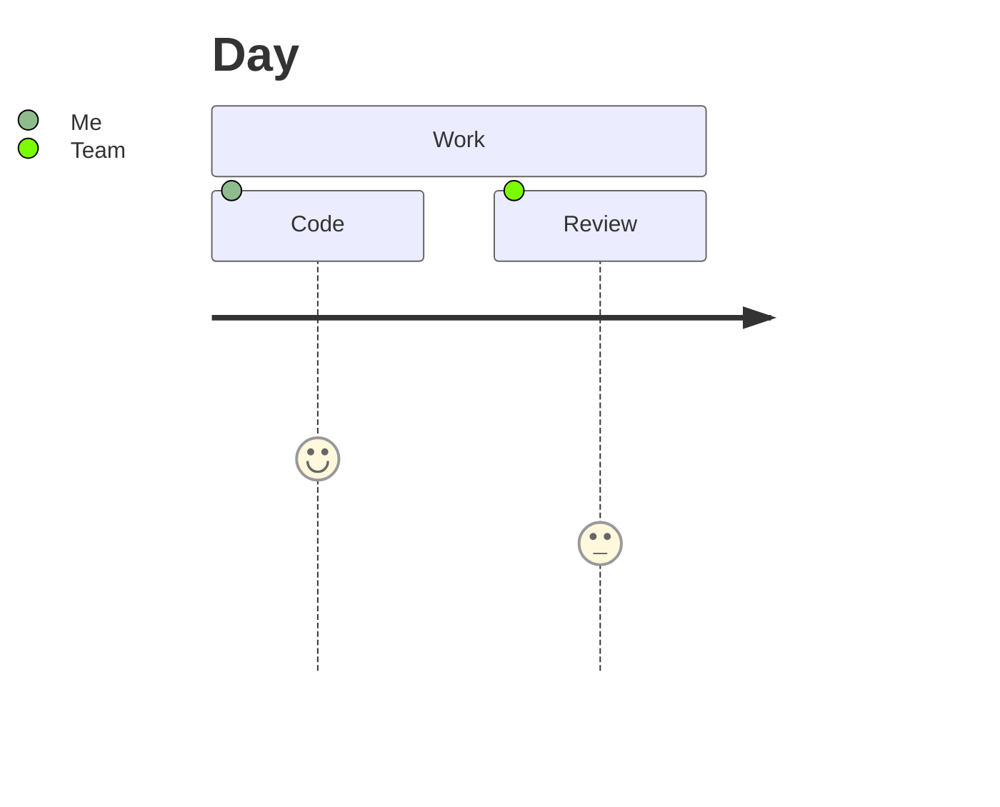

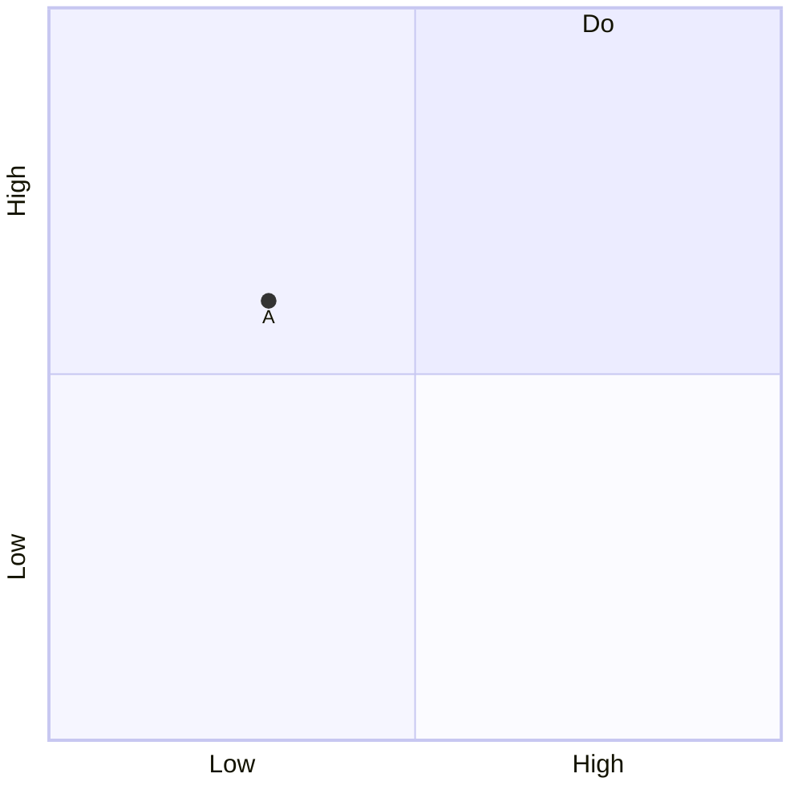

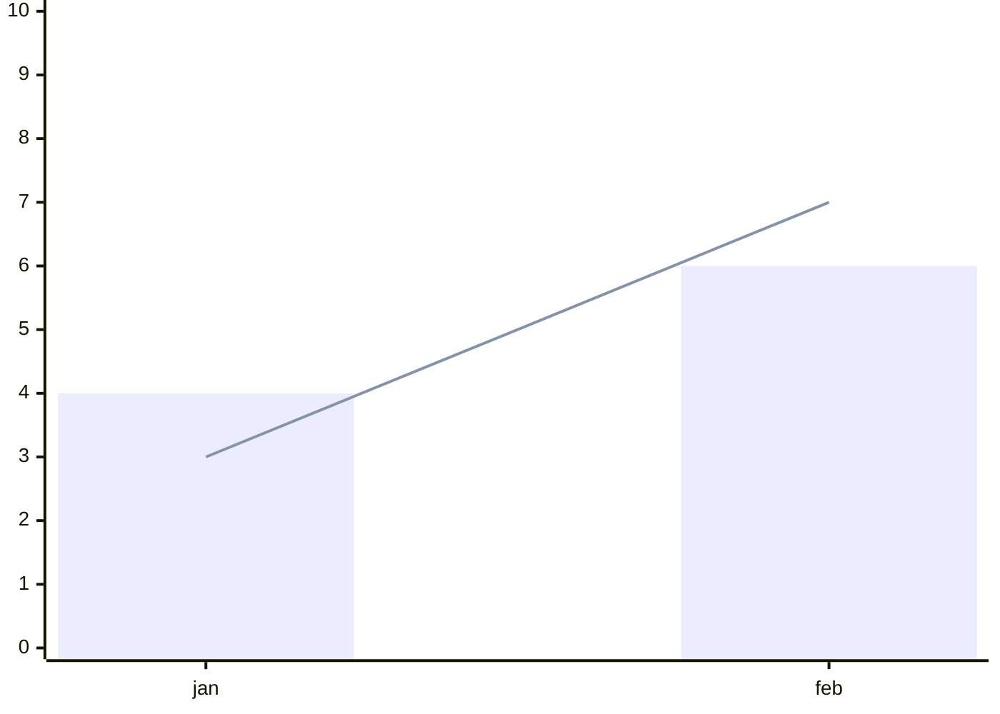

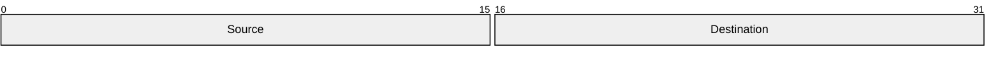

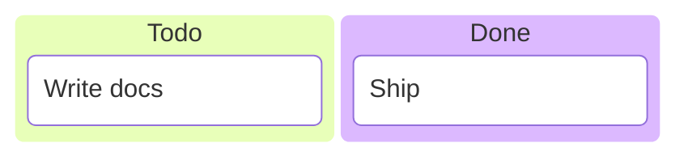

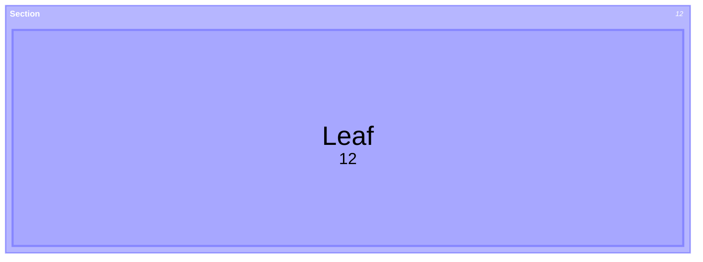

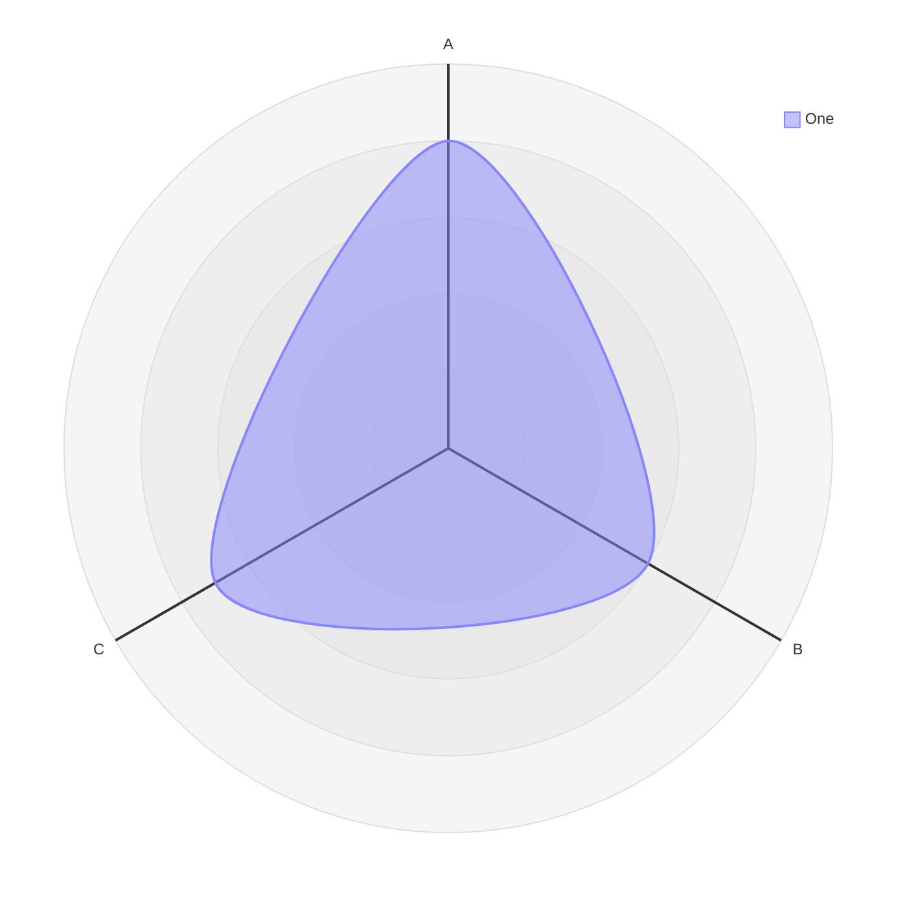

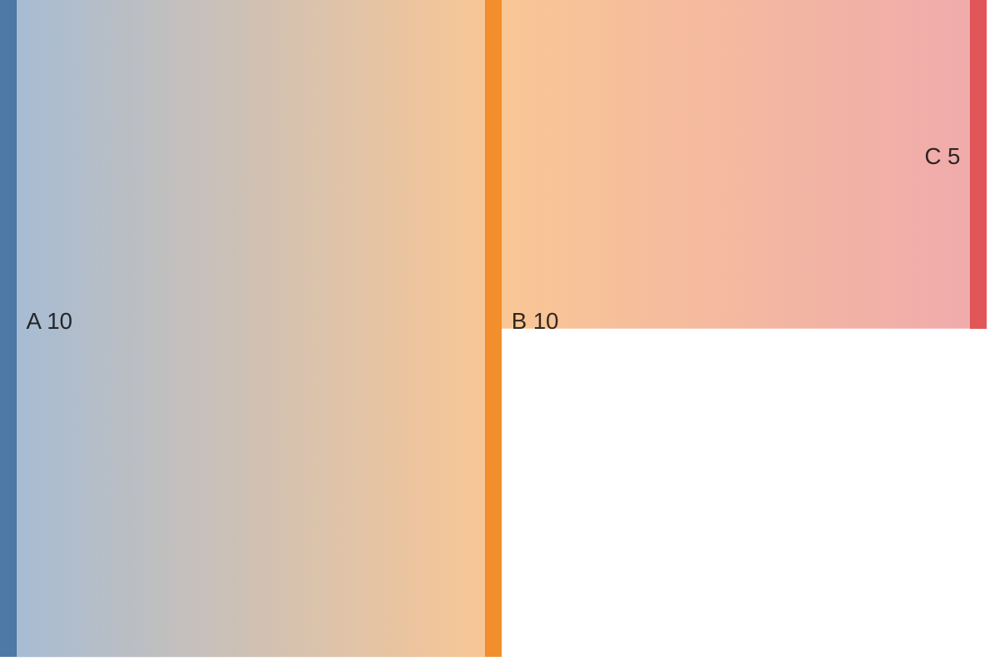

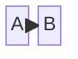

```mermaid
mindmap
  root((center))
    Child
      Leaf
```

```mermaid
timeline
    title History
    2020 : one
    2021 : two
```

```mermaid
C4Context
    Person(user, "User")
    System(sys, "System", "Does things")
    Rel(user, sys, "Uses")
```

```mermaid
requirementDiagram
    requirement R1 {
        text: Must render
    }
    element R2 {
        text: Other
    }
    R1 - satisfies -> R2
```

```mermaid
architecture-beta
    service a(server)[A]
    service b(database)[B]
    a:R -- L:b
```

```mermaid
not a diagram at all
```

Inline math $a^2 + b^2 = c^2$ inside a sentence.

$$
\int_0^1 x \, dx = \frac{1}{2}
$$

Unsupported math follows: $\notarealcommand{$.

| Left | Center | Right |
| :--- | :----: | ----: |
| a    | b      | c     |
| 1    | 2      | 3     |

---

<div class="raw">raw HTML block</div>

<a id="anchor-target"></a>Anchored text follows the anchor.

<div>
<ruby>漢<rt>kan</rt></ruby> is ruby text inside an HTML block.
</div>


Footnote reference[^1] and a second one[^2].

[^1]: The first footnote body.

[^2]: The second footnote body, with a [link](https://example.com).
